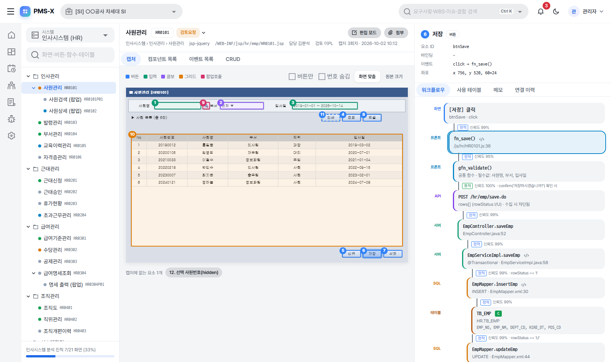
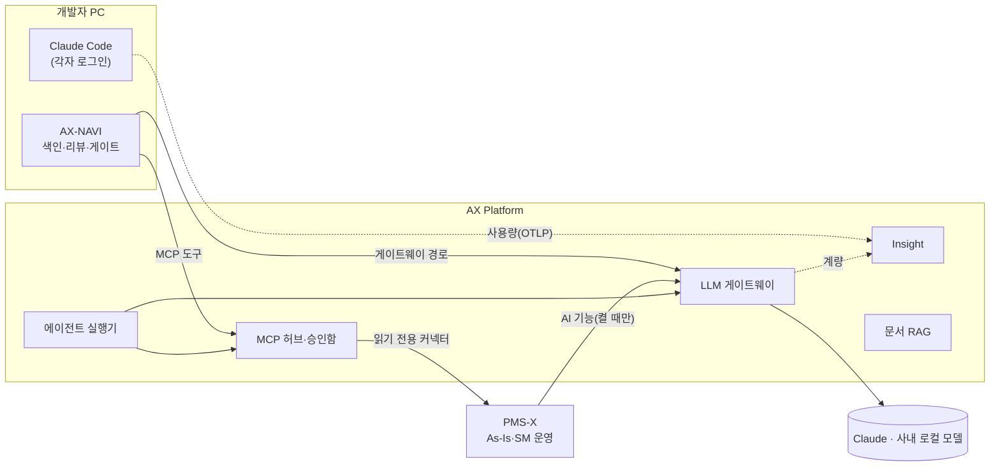

# HNIX AX

HNIX AX는 SI 구축과 SM 운영 현장을 위한 AI 제품군이다. 레거시 코드와 화면을 **스크립트로 전수 분석해 근거를 먼저 만들고**, AI는 그 근거 위에서 설명·분류·요약·변경 검토를 돕는다. 세 제품이 하나의 공통 기반 위에서 같은 데이터를 본다.

  <a class="home-card" href="#/platform/README">
    공통 기반
    <strong>AX Platform</strong>
    LLM 게이트웨이, 사용 현황(Insight), MCP 허브와 승인함, 에이전트 실행기, 문서 RAG. 폐쇄망 설치 패키지 하나로 뜬다.
  </a>
  <a class="home-card" href="#/axnavi/README">
    개발
    <strong>AX-NAVI</strong>
    코드베이스를 전수 색인하고 영향 분석·안전 변경·변경 리뷰·보안 점검·SDLC 단계 게이트를 수행하는 개발 에이전트.
  </a>
  <a class="home-card" href="#/pmsx/README">
    관리·운영
    <strong>PMS-X</strong>
    화면의 버튼 하나가 어떤 함수·API·SQL·테이블로 이어지는지 보여 주는 SI·SM 통합 프로젝트 관리 시스템.
  </a>

<figure>
  
  <figcaption>PMS-X As-Is 화면 분석 뷰어. 저장 버튼을 누르면 <code>fn_save()</code> → <code>POST /hr/emp/save.do</code> → 서비스 → SQL → <code>TB_EMP</code> 흐름이 펼쳐진다.</figcaption>
</figure>

## 무엇이 다른가

| 관점 | 일반적인 AI 도구 | HNIX AX |
|---|---|---|
| 레거시 이해 | 사람이 파일을 골라 보여 주고 AI가 요약한다 | 수집기와 인덱서가 소스·DB·화면을 **전수 분석**해 화면 → 버튼 → 함수 → SQL → 테이블 그래프를 만든다. AI 호출 0회 |
| AI의 역할 | 답을 지어낸다 | 미리 만든 근거 안에서 고르고 설명한다. 근거가 약하면 등급(녹·황·적)으로 드러낸다 |
| 변경 안전 | 승인 대화상자 | 영향 범위·보안 규칙·실행 증거로 GO / HOLD / STOP 판정. 종료 코드로 CI에 바로 연결 |
| 모델 선택 | 한 회사 모델에 고정 | Claude와 사내 로컬 모델을 섞어 쓰고, 데이터 등급에 따라 로컬 모델을 강제한다 |
| 거버넌스 | 도구마다 따로 | 게이트웨이·Claude Code·AX-NAVI·에이전트 사용량을 한 화면에서 같은 기준으로 본다 |
| 설치 | 클라우드 SaaS | 고객사 폐쇄망에 설치. 외부 호출 0건으로 운영할 수 있다 |

## 세 제품이 이어지는 방식

- 지식은 복제하지 않는다. AX Platform은 PMS-X와 AX-NAVI가 이미 가진 그래프를 **커넥터로 읽기만** 한다.
- 모든 모델 호출은 게이트웨이를 지난다. 키 관리·개인정보 마스킹·예산·데이터 등급 라우팅·계량이 한곳에서 일어난다.
- Claude 구독 사용자는 각자 PC에서 각자 로그인해 쓰고, 플랫폼에는 사용량 기록만 온다. 자세한 내용은 [Claude 연결](/getting-started/connect.md)에 있다.

## 처음이라면

1. [제품 구성과 구조](/getting-started/architecture.md)에서 전체 그림을 본다.
2. [빠른 시작](/getting-started/quickstart.md)으로 세 제품을 내 PC에 띄운다.
3. [장애 한 건 따라가기](/getting-started/scenario.md)에서 경보 접수부터 KB 등록까지 세 제품이 이어지는 흐름을 본다.

## 저장소

| 제품 | 저장소 | 기술 |
|---|---|---|
| AX Platform | `Malburi/hnix-ax-platform` (비공개) | TypeScript, Fastify, Vue 3, SQLite·PostgreSQL |
| AX-NAVI | [Malburi/AX-NAVI-CLI](https://github.com/Malburi/AX-NAVI-CLI) · [문서](https://malburi.github.io/AX-NAVI-CLI/) | Node.js CLI, Claude Code 플러그인 |
| PMS-X | `Malburi/hnix-pmsx` (비공개) | Spring Boot 3·Java 21, Vue 3, Python 수집기 |

이 사이트는 제품 소개와 사용 안내다. 설치 파일과 상세 설계 문서는 각 저장소에 있다.

## 오프라인판

인터넷이 안 되거나 GitHub Pages에 접속할 수 없는 곳에서는 오프라인판을 쓴다. [hnix-ax-offline.zip](download/hnix-ax-offline.zip ':ignore')을 받아 풀고 `offline/index.html`을 더블클릭하면 된다. 내용과 화면은 이 사이트와 같고, 검색과 다이어그램도 인터넷 없이 동작한다.
