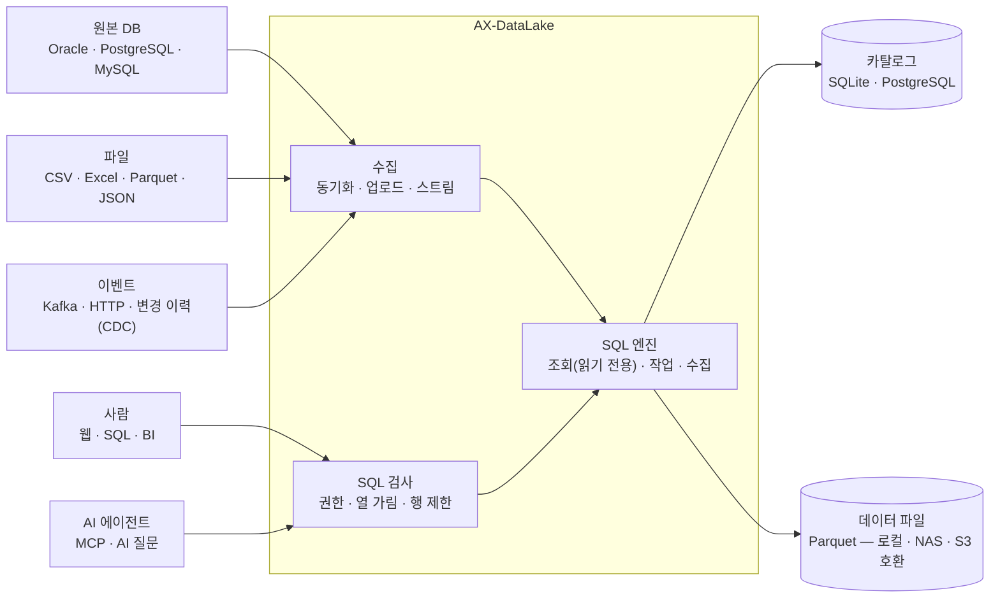

# AX-DataLake

AX-DataLake는 고객사 폐쇄망에서 도는 **레이크하우스**다. 흩어진 업무 DB·파일·이벤트를 표준 파일 형식으로 한곳에 모으고, 사람(SQL·BI)과 AI 에이전트가 **같은 권한·가림 규칙**으로 읽게 한다. 서버 하나로 시작해 저장소와 계산 노드를 나눠 늘릴 수 있다.

<figure><figcaption>분석가(소속 HD01)가 본 <code>hr.employee</code>. 이름·주민등록번호·전화·이메일은 형식별로 가려지고, 행 제한으로 HD01 행만 보인다.</figcaption></figure>

## 왜 필요한가

| 기존 방식 | AX-DataLake |
|---|---|
| 시스템마다 DB 가 따로 있고, 분석할 때마다 담당자에게 추출을 부탁한다 | 원본 DB 를 **읽기 전용**으로 붙여 정해진 주기로 가져온다(통째로·증분·키 병합) |
| 로그·경보·장애 이벤트는 쌓이지 않고 흘러간다 | Kafka 토픽·HTTP 이벤트를 **실시간**으로 받아 테이블에 쌓는다. 멈췄다 다시 켜도 빠지거나 겹치지 않는다 |
| 개인정보가 든 테이블은 통째로 막거나 통째로 연다 | **열 가림**(주민번호·전화·이메일·카드·계좌·이름·주소 형식별)과 **행 제한**(소속별)으로 필요한 만큼만 연다 |
| AI 에 데이터를 맡기면 무엇을 봤는지 모른다 | AI 질문·에이전트도 사람과 같은 규칙으로 읽고, 누가 어떤 경로(화면·API·에이전트·AI 질문)로 무엇을 읽었는지 남는다 |
| 클라우드 데이터 서비스는 폐쇄망에 들어가지 못한다 | **설치본 하나**(Node·SQL 엔진·확장 포함)로 Windows·Linux 서버에 설치. 외부 호출 0건 |

## 구조

- **저장과 계산을 나눈다.** 테이블 목록·시점(스냅샷)은 카탈로그에, 데이터는 공개 표준 Parquet 파일에 둔다. 카탈로그를 PostgreSQL·데이터를 S3 호환 저장소에 두면 서버를 여러 대 띄워 같은 레이크를 함께 쓴다.
- **시점 조회.** 테이블이 바뀔 때마다 시점이 남아, "어제 이 시각의 모습"이나 "두 시점 사이 바뀐 행"을 SQL 로 본다. 장애 원인 분석·감사에 쓴다.
- **엔진을 셋으로 나눠 잠근다.** 분석가 조회는 읽기 전용·파일 접근을 막은 엔진에서, 엔지니어 작업 SQL 은 레이크 폴더 안에서만 쓰는 엔진에서, 수집은 제품 코드만 쓰는 엔진에서 돈다.

## 기능

| 영역 | 내용 | 문서 |
|---|---|---|
| 수집 | 파일 올리기(EUC-KR CSV 자동 변환), 원본 DB 동기화(주기 실행), Kafka·HTTP 실시간(붙이기·키로 바꾸기·변경 반영) | [수집](/datalake/ingest.md) |
| 거버넌스 | 역할(관리자·데이터 엔지니어·분석가), 테이블 조회 권한, 열 가림, 행 제한, 감사·조회 이력 | [거버넌스](/datalake/governance.md) |
| 카탈로그 | 테이블 설명·담당·등급·태그·열 설명, 시점 이력, 바뀐 행, 미리 보기 | [거버넌스](/datalake/governance.md#카탈로그) |
| AI | 자연어 → SQL(플랫폼 게이트웨이, 기밀은 사내 모델만), MCP(에이전트가 같은 규칙으로 조회) | [AI 질문과 에이전트](/datalake/ai.md) |
| 운영 | 폐쇄망 설치본(Windows·Linux 서비스), 매일 파일 정리, API 키(조회·수집·에이전트 범위) | [설치와 운영](/datalake/operations.md) |

## 다른 제품과의 관계

| 제품 | 이어지는 방식 |
|---|---|
| [AX Platform](/platform/README.md) | AI 질문은 **LLM 게이트웨이**로(데이터 등급 라우팅·계량), 레이크 조회 도구는 **MCP 허브**에 외부 서버로 등록 — 허브의 정책·승인·감사 아래에서 에이전트가 쓴다 |
| [PMS-X](/pmsx/README.md) · 고객 ITSM | 장애·SR·운영 이력을 레이크에 쌓아 기간·계열사별 분석, 경보 진단 에이전트의 근거 데이터로 |
| [AX-NAVI](/axnavi/README.md) | 개발자가 IDE 에서 허브를 거쳐 운영 데이터(가린 값)를 조회해 원인 분석에 쓴다 |

통합 점검: [E2E 꾸러미](/getting-started/e2e-kit.md)의 ⑱(허브 경유 레이크 조회 — 분석가 권한의 가림·행 제한 그대로)과 ⑲(AI 질문 — 사내 모델이 SQL 작성, 행 제한 적용)이 실제로 돈다.
