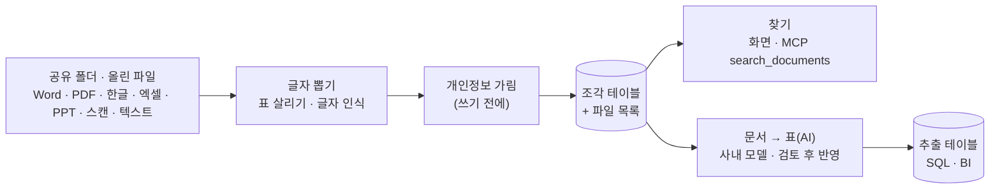

# 문서(비정형) — 수집 · 찾기 · 문서 → 표(AI)

운영 매뉴얼·절차서·장애 보고·견적서·계약서처럼 **표가 아닌 문서**도 레이크에 넣는다. 넣은 문서는 표와 같은 [거버넌스](/datalake/governance.md)(조회 권한·열 가림·행 제한·감사) 아래에서 사람과 에이전트가 찾아 읽는다. 문서 안의 값(거래처·금액·기한…)은 **AI 로 뽑아 표**로 만들어 SQL 로 분석한다.

<video controls preload="metadata" poster="video/features/datalake-4.jpg" src="video/features/datalake-4.mp4" style="width:100%;border-radius:10px"></video>

> 보고서형 엑셀 → 시트마다 테이블 → SQL, 여섯 형식 문서의 파일 목록과 찾기, '견적서 요약' 정의 → 사내 모델 추출 → 승인, 모델이 틀린 계약 요약을 고쳐서 승인 → 추출 테이블·계보를 실제로(3분 16초). [기능 전체 영상](/demo/features.md#ax-datalake)

## 문서 수집

관리자가 **문서 묶음**을 만든다 — 서버에서 본 폴더(공유 폴더·NAS) 또는 화면에서 올린 파일. 결과는 레이크 테이블 두 개(`스키마.테이블` 조각, `스키마.테이블_files` 파일 목록)에 들어간다. 다시 실행하면 바뀐 파일만 다시 넣고, 폴더에서 사라진 파일은 지운다. 주기 실행도 된다.

| 형식 | 읽는 방법 |
|---|---|
| Word(docx) | 제목 스타일(제1조 …)을 조각 제목으로, 표는 구조 그대로 |
| PDF | 글자 층을 좌표로 다시 세워 칸 정렬이 이어지는 줄을 **표**로. 가운데 정렬 머리글도 표 머리글로 붙인다. 쪽 번호를 제목으로 |
| 한글(HWP 5.0 · HWPX) | 외부 프로그램 없이 본문·표 |
| 엑셀(xlsx · xls) | 시트마다 표로 편 내용([보고서형 시트 펴기](/datalake/ingest.md#엑셀))을 표 묶음으로. **조각마다 머리글을 다시** 달아 열 이름과 값의 짝이 끊기지 않는다 |
| 파워포인트(pptx) | 슬라이드 순서대로 제목·글 상자·표·**발표자 메모** |
| 스캔 PDF · 이미지(png·jpg) | **글자 인식**(한국어·영어) — 이 서버 안에서만 돈다. 테두리 있는 표도 행을 살려 표로 바꾼다. 문서마다 확신도를 남긴다 |
| HTML · 텍스트 · 소스 코드 | 그대로(EUC-KR 자동) |

### 개인정보 — 레이크에 쓰기 전에

글자를 뽑은 뒤 **저장하기 전에** 찾아 처리한다. 저장되는 글자 자체가 가려지므로, 나중에 누가 어떤 길(화면·SQL·에이전트)로 읽어도 원래 값은 없다.

| 처리 | 결과 | 기본으로 쓰는 종류 |
|---|---|---|
| 이름표 | `[주민번호]` — 값이 남지 않음 | 주민등록번호 · 카드번호 |
| 부분 가림 | `010-****-5678` · `m***@example.co.kr` | 전화번호 · 이메일 |
| 세기만 | 그대로 두고 건수만 | 사업자등록번호(공개 정보) |
| 문서 제외 | 그 종류가 나오면 문서를 넣지 않음 | (묶음마다 고른다) |

PDF 의 좁은 칸에서 줄이 바뀌어 `02-3456-` 과 `7890` 이 다른 줄로 갈라진 번호·이메일도 뒤 몇 줄에서 이어지는 부분을 찾아 이어 본 뒤 가린다(이어 붙여 온전한 값이 될 때만).

| 원본 회의록 | 레이크에 저장된 조각 |
|---|---|
| 참석: 인사팀 정민아(`010-2468-1357`, `mina.jung@example.co.kr`) | 참석: 인사팀 정민아(`010-****-1357`, `m***@example.co.kr`) |
| 테스트 사원 계정(주민번호 `900101-1234567`)은 운영 DB 에서 지운다. | 테스트 사원 계정(주민번호 `[주민번호]`)은 운영 DB 에서 지운다. |

<figure><figcaption>시연 샘플 '서버 정기 점검표' 스캔. 글자 인식으로 표의 네 행(PAY-WAS01 … PAY-BATCH)을 마크다운 표로 살린다. 스캔 품질에 따라 '디스크 → 티스크' 같은 오독이 남으니 확신도가 낮으면 원본을 본다.</figcaption></figure>

### 조각과 임베딩

제목(#) 경로를 따라 900자 안팎으로 나누고, 조각마다 `heading`(예: `슬라이드 3. 원인 분석`, `제2조 (계약 금액)`)이 붙어 근거로 쓴다. 묶음에서 임베딩을 켜면 **가린 뒤의 조각만** 플랫폼 게이트웨이 임베딩 모델로 보낸다(기밀 묶음은 사내 모델만).

## 찾기

화면 '문서 찾기'(엔지니어·관리자에게는 '문서 수집')의 찾기, 또는 에이전트가 MCP `list_document_collections` · `search_documents` 로. 낱말 점수(한국어 조사를 뗀 말도) + 임베딩 의미 검색을 순위 합으로 섞는다. 검색도 사람이 쓴 SQL 과 같은 길로 돌아, 조각 테이블 권한이 없으면 거부되고 행 제한·가림이 그대로 걸린다.

| 물음 | 첫 결과(시연 샘플 6개 — 형식이 다 다름) |
|---|---|
| 급여 배치가 늦어진 원인 | 장애 보고 PPT › 슬라이드 3. 원인 분석 |
| 디스크 증설이 필요한 서버 | 점검표 스캔(글자 인식) |
| 유지보수 월 금액과 자동 연장 | 계약서 Word › 제2조 (계약 금액) |
| 9월 급여 처리 기한 준수율 | 운영 실적 엑셀 › 시트: 서비스별 실적 |

## 문서 → 표(AI 추출)

견적서·계약서·점검 보고서는 **문서 안의 값**을 모아 봐야 할 때가 많다. 화면 '문서 → 표(AI)'(데이터 엔지니어·관리자)에서 뽑을 항목을 정하면, 플랫폼 게이트웨이의 모델이 문서마다 값을 뽑아 레이크 테이블의 행으로 만든다.

<figure><figcaption>추출 정의 2개(견적서 요약 · 계약 요약)와 검토 목록. 사내 모델로 문서당 2~5초.</figcaption></figure>

1. **정의** — 문서 묶음 + 대상 테이블 + 뽑을 항목(이름 · 타입[글자·숫자·정수·날짜·예/아니오] · 모델에게 주는 설명) + 문서 하나에 **한 행**(머리 정보) / **여러 행**(품목 표처럼). 경로 걸러내기·추가 지시. 견적서 요약·견적 품목·계약 요약 예시로 채울 수 있다.
2. **실행** — 묶음의 조각을 문서 순서대로 다시 이어 모델에 보낸다. **모델에는 개인정보를 이미 가린 본문만** 가고, 등급은 묶음 등급을 따른다(기밀 → 사내 모델만). 답은 타입에 맞게 바꾼다(`1,234,000원` → 1234000, `2026년 12월 5일` → 2026-12-05, 없는 날짜는 비움).
3. **검토(기본)** — 뽑은 값은 '검토 대기'. **승인 · 고쳐서 승인**한 문서만 테이블에 쓰고, 버리면 그 문서의 행을 뺀다. 확인을 끄면 뽑는 즉시 반영한다.
4. **다시 실행** — 바뀐 문서만 다시 뽑고(승인 전까지 예전 값 유지), 실패한 문서는 다시 해 보고, 묶음에서 사라진 문서는 행을 지운다.

추출 테이블에는 정한 열과 함께 `_path`(원본 문서) · `_row` · `_org`(행 제한용) · `_model` · `_approved_by` · `_extracted_at` 이 남고, [계보](/datalake/lineage.md)에 `조각 테이블 → 추출 테이블 (AI 추출)` 이 그려진다.

| 시연 결과(사내 3B 모델) | 뽑은 값 |
|---|---|
| 견적서 PDF → 요약 | 거래처 (주)한빛상사 · 견적일 2026-11-07 · 합계 103,950,000 · 유효기한 2026-12-06 — 원문과 같음 |
| 견적서 PDF → 품목(여러 행) | 서버 2 × 18,500,000 · 스토리지 1 × 42,000,000 · 백업 소프트웨어 · 설치·이관 용역 — 4행 |
| 장애 보고 PPT → 요약 | 2026-10-25 · 급여 배치 지연 · 2시간 30분 · 등급 2 · 원인(두 줄을 한 문장으로) |
| 계약서 Word → 요약 | 모델이 '갑' 으로만 적힌 상대방을 놓치고, 대응 시작(1시간)과 복구 기한(4시간)을 헷갈림 → **검토 화면에서 고쳐 승인** |

> 작은 사내 모델은 '갑·을' 로 돌려 쓰는 계약서에서 자주 틀린다. 그래서 기본값이 '확인 후 반영'이다. 정확도가 더 필요하면 게이트웨이에 더 큰 사내 모델을 연결한다.

## 통합 점검

[E2E 꾸러미](/getting-started/e2e-kit.md)의 ㉑(보고서형 엑셀 → 테이블 → SQL 집계), ㉒(여섯 형식 문서를 가려 넣고 찾기 — 원본 개인정보가 하나도 남지 않는지, 스캔 표·PDF 표 머리글), ㉓(견적서 → 사내 모델 추출 → 검토 대기 → 승인 → 테이블·계보)가 이 쪽의 시연 샘플로 실제로 돈다.
