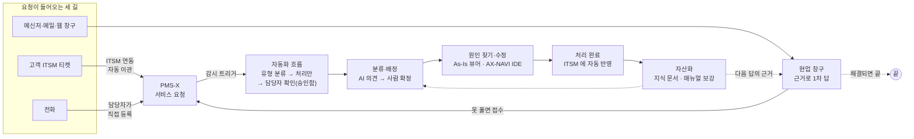

# SM 업무 흐름 시나리오

유지보수(SM) 담당자의 하루를 **요청 한 건 단위**로 따라가는 영상이다. [시연 영상](/demo/README.md)이 제품별로, [기능 전체 영상](/demo/features.md)이 화면별로 보여 준다면, 이 쪽은 요청이 들어와서 닫히고 지식으로 남기까지 **여러 제품을 오가는 순서 그대로** 보여 준다. 모두 실제로 띄운 제품(E2E 환경)을 조작하며 녹화했고, 모델이 답하는 장면은 사내 로컬 모델(`hnix-local`)이 그 자리에서 낸 답이다.

## 전체 흐름

요청은 세 길(고객 ITSM·메신저와 메일·전화)로 들어오지만, 모두 **PMS-X 서비스 요청 하나**로 모인다. 한 건을 닫을 때마다 지식 문서·매뉴얼이 늘어, 다음 같은 질문은 현업 창구와 에이전트가 답한다.

착수 때는 이 흐름 앞에 두 단계가 있다 — **현행 파악**(PMS-X 수집기로 화면·SQL·테이블, AX-NAVI 로 코드 색인, AX-DataLake 로 DB, 문서 검색으로 매뉴얼)과 **연결 구성**(Platform → PMS-X → AX-NAVI·AX-DataLake → 에이전트 순서). 영상은 그 준비가 끝난 운영 단계부터다.

## 시나리오 A — 고객 ITSM 으로 들어온 티켓 (12분 4초)

<video controls preload="none" poster="video/scenarios/sm-a.jpg" src="video/scenarios/sm-a.mp4" style="width:100%;border-radius:10px"></video>

고객 ITSM 이 기록의 원본이고, 우리 일은 PMS-X 서비스 요청에서 한다. 사람은 티켓을 옮겨 적지 않는다. 새 요청은 **자동화 흐름**이 먼저 받아 유형을 가르고 처리안을 만든 뒤 담당자 확인을 받고, 코드 수정은 개발자가 **AX-NAVI IDE** 에서 요청 번호만 주고 맡긴다 — IDE 는 로그인만으로 플랫폼 MCP 허브에 연결돼 PMS-X 와 코드 색인을 함께 쓴다. 영상의 고객 ITSM 은 플랫폼에 든 **시험용 가상 ITSM**(ServiceNow 형식)이다.

| 단계 | 누가 · 어디서 | 하는 일 |
| --- | --- | --- |
| ① 접수 | 고객 · 고객 ITSM | "사원 조회에 퇴사자가 같이 나와요" 티켓 등록(김현업, 인사팀) |
| ② 자동 이관 | Platform ITSM 연동 | '지금 동기화'(평소엔 웹훅 또는 5분 주기) → PMS-X 서비스 요청 접수, 티켓에는 요청 번호 댓글, 처리 기한 시작 |
| ③ 자동화 흐름 | Platform 감시 트리거 → 자동화 흐름 | 감시 트리거가 PMS-X 서비스 요청 목록(`pmsx__srs`)에서 새 요청을 잡아 '서비스 요청 분류·처리' 흐름을 깨움 — 유형 분류(사내 모델) → 갈래 → 장애 담당 에이전트 / 지식 문서 검색 → 담당자 확인에서 멈춤. 실행은 SM 담당자 권한, 캔버스와 실행 디버거에 단계가 남음 |
| ④ 담당자 확인 | SM 운영 책임자 · MCP 허브 승인함 | 흐름이 올린 분류 결과·처리안을 검토하고 승인 → 흐름이 이어 가 '처리안 확정' |
| ⑤ 분류 확정·배정 | 사내 모델 → 사람 · PMS-X | AI 분류 추천(유형·우선순위·대상 화면·담당 후보, 비슷한 과거 요청·지식 문서가 근거) → 반영 → 분류 완료 → 담당 배정 → 처리 시작, 대상 화면('사원관리') 잇기 |
| ⑥ 원인 찾기 | SM 담당자 · PMS-X | 구현 명세(버튼 흐름·영향 테이블·소스 위치·테스트), As-Is 화면 뷰어 |
| ⑦ 고치기 | 개발자 · AX-NAVI IDE | 요청 번호만 주고 맡김 — 에이전트가 플랫폼 MCP 허브의 `pmsx__srs` 로 요청을 읽고 코드 색인으로 `HR_EMP` 이름 조회 SQL(`EmpDao.searchByName`)을 찾아 재직 조건을 넣음. 조회 도구는 확인 없이 바로, 파일 수정만 개발자가 승인 |
| ⑧ 처리 완료 | SM 담당자 · PMS-X | 처리 내용(재직 조건 추가·리뷰 통과·배포)을 남기고 '처리 완료' |
| ⑨ 고객 반영 | Platform ITSM 연동 | 티켓 상태 Resolved, 동기화 기록에 들어온 것·나간 것 |
| ⑩ 자산화 | SM 담당자 · PMS-X | AI 지식 문서 초안(증상·원인·조치) → 지식 문서 등록 |

장애 경보에서 시작하는 요청(예: 야간 배치 실패)은 ②가 다르다 — 경보가 웹훅으로 들어오면 '경보 진단' 에이전트가 비슷한 과거 장애와 매뉴얼로 원인 후보와 확인 순서를 정리하고, 반복 조치는 [런북](/platform/runbooks.md)을 승인받아 실행한다.

## 시나리오 B — 메신저·메일과 전화로 들어온 요청 (5분 36초)

<video controls preload="none" poster="video/scenarios/sm-b.jpg" src="video/scenarios/sm-b.mp4" style="width:100%;border-radius:10px"></video>

메신저·메일은 **현업 창구가 먼저 답하고**, 못 답한 것만 서비스 요청이 된다. 전화는 사람이 받되, **바로 끝난 문의도 서비스 요청으로 남긴다** — 기록이 없으면 처리 실적과 지식으로 남지 않기 때문이다.

**B-1 메신저·메일·웹 창구**

1. 현업 직원이 창구를 연다 — 창구마다 고객사 색·로고, 첫 화면에 자주 묻는 질문 버튼. Teams 채널·메일로도 같은 창구다.
2. 마이크로 **말로 묻는다** — "사원 조회 화면에 퇴사자가 같이 나와요" → 사내 음성 인식 모델(게이트웨이 별칭)이 글로 바꾸고, 운영 매뉴얼 절을 근거 번호로 단 답 → **해결됐어요**(자동 해결률로 센다).
3. "회의실 예약은 어떻게 하나요?" → 근거가 없으니 지어내지 않고 모른다고 한다 → **담당자에게 넘기기** → 대화 기록과 함께 PMS-X 서비스 요청 접수, 번호가 바로 돌아온다. 접수된 요청은 시나리오 A 와 같은 자동화 흐름으로 들어간다.
4. 담당자 — 머리의 **종 알림**에 "창구 질문이 담당자에게"(Teams·Slack·메일 게이트웨이로도 보낼 수 있다).
5. **매뉴얼 보강** — 답을 적으면 창구 근거 문서로 들어가고, 같은 질문을 다시 물어 이제 답하는지 확인한다. 다음 사람은 담당자를 기다리지 않는다.

**B-2 전화**

1. SM 담당자가 전화를 받고, 통화 중에 **워크스페이스 채팅**(운영 매뉴얼 문서함)으로 "계정이 잠겼다"는 문의의 답을 찾아 안내한다.
2. PMS-X 에 **요청 등록** — 접수 경로 '수기', 요청자·소속·연락처.
3. 분류 → 배정 → 처리 시작 → **처리 완료**. 즉답이 안 되면 배정에서 멈추고 시나리오 A 의 원인 찾기부터 같은 흐름이다.
4. 같은 문의가 자꾸 전화로 오면 현업 창구 주소나 고객 요청 창구로 안내해 B-1 길로 옮긴다.

## 자산화 — 한 건을 닫을 때마다

| 계기 | 남길 것 | 다음에 읽는 곳 |
| --- | --- | --- |
| 서비스 요청 종료 | 지식 문서(AI 초안 → 사람 확인) | 현업 창구·분류 의견·경보 진단의 유사 사례 |
| 창구가 답을 못 찾음 | 매뉴얼 보강(근거 문서함에 문서로) | 다음 창구 답 |
| 채팅에서 쓸 만한 답 | '문서로 저장'(근거 목록 포함) | 채팅·창구·에이전트 |
| 같은 조치를 반복 | 런북(승인 후 실행, 되돌리기) | 경보 진단 뒤 조치 |
| 화면·SQL 을 고침 | 변경분 재수집 | As-Is 뷰어·영향도 분석 |

매달에는 PMS-X 월간 운영보고, 플랫폼 생산성 보고서, 창구 성과(자동 해결률·접수율)를 함께 본다. 자동 해결률이 오르고 '매뉴얼 보강 대기'가 줄면 이 고리가 돌고 있다는 뜻이다.

> 영상을 다시 찍을 때: E2E 환경을 띄운 뒤 `node tools/scenario-prep.mjs` → `node tools/record-demo.mjs --scenarios scenario-scenarios.mjs --scenario sm-a --out video/scenarios`(B 는 `sm-b`).
