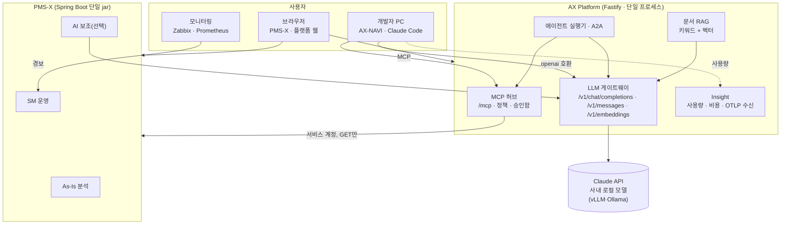

# 제품 구성과 구조

HNIX AX는 세 제품으로 이루어진다. 각 제품은 혼자서도 동작하고, 함께 쓰면 같은 화면·코드 자산과 같은 AI 기반을 공유한다.

| 제품 | 누가 쓰나 | 하는 일 | 단독 실행 |
|---|---|---|---|
| **AX Platform** | 관리자, 개발자, 운영자 | LLM 게이트웨이, 사용 현황, MCP 허브·승인, 에이전트, 문서 검색 | 가능 |
| **AX-NAVI** | 개발자 | 코드 색인, 영향 분석, 안전 변경, 변경 리뷰, 보안 점검, SDLC 게이트 | 가능 (Claude만 있으면) |
| **PMS-X** | PM, 분석자, 운영자, 고객 | As-Is 화면 분석, 일정·인력·산출물·품질, SM 운영(SR·SLA·장애) | 가능 (AI 기능은 꺼진 채로) |

## 설계 원칙

1. **근거 먼저, AI는 나중.** 화면·버튼·함수·SQL·테이블의 연결은 수집기와 인덱서가 결정론적으로 만든다. 같은 입력에는 늘 같은 결과가 나온다. AI는 그 결과 안에서 고르고 설명한다.
2. **지식은 한 곳에.** 플랫폼은 PMS-X와 AX-NAVI의 그래프를 복제하지 않는다. 커넥터가 필요할 때 읽기 전용으로 조회한다.
3. **모델 호출은 게이트웨이로.** 키, 개인정보 마스킹, 예산, 데이터 등급, 계량을 한 곳에서 처리한다. 기밀 데이터는 사내 로컬 모델로만 간다.
4. **AI는 켤 때만.** PMS-X의 AI 기능은 기본으로 꺼져 있다. 끈 상태에서는 외부 호출이 0건이다.
5. **사람이 확정한다.** AI가 만든 분류·설명·KB는 모두 초안이다. 반영 버튼은 사람이 누른다.

## 전체 구조

## 데이터가 흐르는 길

| 흐름 | 경로 | 남는 기록 |
|---|---|---|
| PMS-X의 SR 분류 추천 | PMS-X → 게이트웨이 → 모델 | 게이트웨이 요청 로그(본문 없음), Insight 사용량 |
| AX-NAVI 질문(게이트웨이 경로) | AX-NAVI → 게이트웨이 → 모델 | 같음. 호출 주체가 `axnavi`로 구분된다 |
| AX-NAVI 질문(구독 경로) | AX-NAVI → 본인 Claude Code → Anthropic | 본인 PC의 세션 로그, 텔레메트리를 켜면 Insight 사용량 |
| 에이전트가 SR 조회 | 실행기 → 허브 → PMS-X | 실행·단계 기록(본문 없음), 허브 호출 기록(인자 이름·크기만) |
| 문서 검색 | 플랫폼 → 게이트웨이(임베딩) → 모델 | 사용량 |

요청·응답 본문은 어디에도 저장하지 않는다. 자세한 원칙은 [데이터·보안 원칙](/reference/security.md)에 있다.

## 기술 구성

| 제품 | 서버 | 웹 | 저장소 | 배포 |
|---|---|---|---|---|
| AX Platform | Node.js 24, Fastify 5, Kysely | Vue 3, Naive UI | SQLite(기본, sqlite-vec) · PostgreSQL | win-x64 zip · linux-x64 tar.gz (Node 런타임 포함), WinSW · systemd |
| AX-NAVI | Node.js CLI | 터미널 | 저장소의 `_workspace/index` | npm 패키지, 폐쇄망 tgz |
| PMS-X | Spring Boot 3, Java 21 | Vue 3, Vuetify | PostgreSQL · Oracle · Tibero · SQL Server · H2 | 단일 jar + 내장 JRE 오프라인 패키지 |
