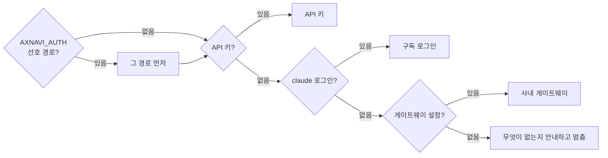

# Claude 연결 — 구독·키·게이트웨이

개발자마다 가진 것이 다르다. 개인 Pro·Max 구독, 회사 Team·Enterprise 좌석, Bedrock·Vertex 계약, API 키, 아무것도 없는 사람이 한 팀에 섞여 있다. HNIX AX는 **요금제를 보지 않는다.** "누구의 자격으로, 어디서 Claude를 부르는가"만 세 경로로 나눈다.

| 경로 | 해당하는 사람 | 어디서 부르나 | 과금 |
|---|---|---|---|
| **구독 로그인** | `claude`에 로그인한 사람: 개인 구독, Team·Enterprise 좌석, `claude setup-token` 토큰, Claude Code에 Bedrock·Vertex를 설정한 경우 | 본인 PC의 Claude Code | 본인 구독·좌석, 또는 클라우드 계약 |
| **API 키** | `ANTHROPIC_API_KEY`가 있는 사람 | 본인 PC에서 직접 | 키 주인 |
| **사내 게이트웨이** | 위 둘이 없거나, 조직이 게이트웨이를 강제한 사람 | AX Platform 게이트웨이 → 조직 API 키 또는 사내 로컬 모델 | 조직 |

## 구독은 각자 PC에서만

Anthropic은 승인 없이 제3자 제품(Agent SDK로 만든 에이전트 포함)이 claude.ai 로그인을 쓰는 것, 그리고 서버가 사용자를 대신해 구독 자격 증명으로 요청을 중계하는 것을 허용하지 않는다([Agent SDK 개요](https://code.claude.com/docs/en/agent-sdk/overview), [법률·준수](https://code.claude.com/docs/en/legal-and-compliance)).

그래서 HNIX AX는 이렇게 나눈다.

- **개발자 PC의 도구(AX-NAVI)**: 구독을 쓸 때는 본인이 로그인한 Claude Code에 작업을 맡긴다. AX-NAVI가 구독 자격을 직접 읽지 않는다.
- **여러 사람을 대신하는 서버 기능(게이트웨이, PMS-X AI, 공통 에이전트)**: 조직 API 키나 사내 로컬 모델만 쓴다.
- **사용량 관측**: 구독 사용자의 Claude Code도 텔레메트리로 사용량만 플랫폼에 보낸다. 자격 증명은 서버로 오지 않는다.

## AX-NAVI가 경로를 고르는 순서



- 조직 정책이 허용하지 않는 경로는 건너뛴다.
- 로그인 기록이 없으면 구독을 건너뛴다. 설치만 보고 고르면 첫 요청에서 "Not logged in"으로 실패하기 때문이다.
- 구독과 키를 둘 다 가졌다면 `AXNAVI_AUTH=subscription`으로 구독을 먼저 쓸 수 있다. 이때 AX-NAVI는 위임 프로세스에서 API 키를 뺀다. Claude Code는 키가 있으면 키를 먼저 쓰기 때문이다.
- `axnavi doctor`의 **과금** 줄이 지금 누구에게 과금되는지 보여 준다.

```text
✓ 실행 경로  claude-cli 2.1.310 · 구독 인증 · 도구 제약은 claude 권한 체계가 강제합니다
✓ 과금       본인 Claude 로그인(Pro·Max·Team·Enterprise) — 본인 구독·좌석 한도
```

## 내 연결 설정 화면

AX Platform의 **내 연결 설정**에서 상황과 터미널 종류를 고르면, AX-NAVI 환경변수와 Claude Code 텔레메트리 설정이 만들어진다. **필요한 키 발급**을 누르면 수집 키와 게이트웨이 키가 발급되어 설정에 바로 채워진다. Claude 자격 증명은 이 화면에 넣지 않는다.

<figure>
  
  <figcaption>내 연결 설정. 관리자에게는 조직 정책 파일과 Claude Code 관리 설정 생성기가 함께 보인다.</figcaption>
</figure>

### 상황별 설정 예

**구독·좌석** — 한 번 로그인하고, 선호 경로와 사용량 전송만 넣는다.

```powershell
claude      # 브라우저가 열리면 로그인
[Environment]::SetEnvironmentVariable("AXNAVI_AUTH", "subscription", "User")
[Environment]::SetEnvironmentVariable("HNIX_AX_SERVER", "http://ax-platform:8700", "User")
[Environment]::SetEnvironmentVariable("HNIX_AX_KEY", "hx-<수집 키>", "User")
```

로그인 창을 띄울 수 없는 CI에서는 본인이 `claude setup-token`으로 만든 토큰을 그 작업의 비밀 변수 `CLAUDE_CODE_OAUTH_TOKEN`에 넣는다.

**아무것도 없음** — 사내 게이트웨이로 쓴다. 비용은 조직에 잡힌다.

```bash
export AXNAVI_AUTH="gateway"
export AXNAVI_OPENAI_BASE_URL="http://ax-platform:8700/v1"
export AXNAVI_OPENAI_API_KEY="hx-<게이트웨이 키>"
export AXNAVI_OPENAI_MODEL="hnix-claude"
```

## 조직 정책

관리자는 PC 공용 정책 파일로 허용 경로를 정한다. 개발자 권한으로 고칠 수 없는 위치에 둔다.

| OS | 위치 |
|---|---|
| Windows | `%ProgramData%\axnavi\policy.json` |
| macOS | `/Library/Application Support/axnavi/policy.json` |
| Linux | `/etc/axnavi/policy.json` |

```json
{
  "allowedRoutes": ["subscription", "gateway"],
  "preferred": "subscription",
  "gateway": { "baseUrl": "http://ax-platform:8700/v1", "model": "hnix-claude" },
  "message": "기밀 과제는 사내 게이트웨이만 씁니다"
}
```

- `gateway`를 적어 두면 개발자는 게이트웨이 키만 넣으면 된다.
- 저장소의 `.axnavi/policy.json`은 허용 경로를 **더 좁히기만** 한다. 예를 들어 기밀 저장소는 `["gateway"]`로 사내 모델만 쓰게 한다. 넓히거나 게이트웨이 주소를 바꾸지는 못한다.
- 정책을 벗어난 선택은 이유를 보여 주고 멈춘다. 정책 파일이 깨져 있으면 실행하지 않는다.

```text
--provider claude-cli 는 조직 정책에서 허용하지 않습니다.
  허용 경로: 사내 게이트웨이
  안내: 기밀 과제는 사내 게이트웨이만 씁니다
```

## 팀 단위로 도입할 때

| 상황 | 권장 |
|---|---|
| 개발자 대부분이 구독이나 좌석을 갖고 있다 | 정책 `preferred: subscription`, 게이트웨이는 대체 경로로. 사용량은 Claude Code 관리 설정으로 텔레메트리를 일괄 적용 |
| 좌석이 없는 협력사 인력이 섞여 있다 | 그 사람들은 게이트웨이 키만 받는다. 모델 별칭과 분당 한도를 키에 건다 |
| 기밀 과제가 있다 | 그 저장소에 `.axnavi/policy.json`으로 `["gateway"]`, 게이트웨이에서 데이터 등급 `restricted` → 사내 로컬 모델 |
| 비용을 과제별로 나누고 싶다 | 브랜치 이름에 작업번호(`feature/SR-2026-0142`)를 쓰면 Insight가 SR·CR별로 묶는다 |
