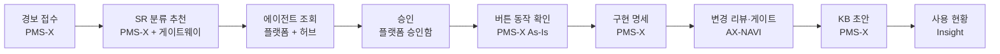

# 장애 한 건 따라가기

새벽에 인사 시스템 야간 배치가 실패했다. 이 한 건을 경보 접수부터 원인 분석, 변경 검토, 지식 등록까지 따라가며 세 제품이 어떻게 이어지는지 본다. 화면은 모두 시연 데이터(가상의 ○○공사 인사시스템)로 실제 연동한 상태에서 캡처했다.



## 1. 경보가 장애와 SR로 바뀐다

모니터링 도구가 보낸 경보 4건이 들어왔다. critical은 장애로, warning은 SR로 만들어졌고 info는 기록만 남았다. 같은 배치 실패가 두 번 와도 장애는 하나로 묶였다(×2).

<figure><figcaption>PMS-X › 운영(SM) › 장애 › 경보</figcaption></figure>

## 2. SR 분류·배정을 AI가 추천한다

고객 포털로 들어온 "사원 조회 시 퇴사자가 함께 나옵니다"를 열고 **분류·배정 추천**을 누른다. 유형·우선순위·대상 화면·담당자가 채워진다. AI는 PMS-X가 먼저 좁혀 둔 후보 안에서만 고르고, 운영자가 **반영**을 눌러야 확정된다.

<figure><figcaption>모델 별칭(hnix-local)이 패널에 표시된다.</figcaption></figure>

## 3. 공통 에이전트가 PMS-X를 조회한다

플랫폼의 SM 운영 도우미 에이전트에게 "퇴사자 관련 SR을 찾아 처리 방향을 알려줘"라고 묻는다. 에이전트는 실행한 사람의 권한으로 돌고, 모델 → 도구(`pmsx__srs`) → 모델 단계가 모두 기록된다.

<figure><figcaption>플랫폼 › 에이전트</figcaption></figure>

## 4. 개인정보가 담긴 조회는 승인 후에

SR 상세에는 요청자 개인정보가 있다. 정책 "SR 상세 조회는 승인 후"에 걸린 요청은 승인함에서 책임자가 결정한다. 승인은 같은 인자로 한 번, 하루 안에만 쓸 수 있고 본인 요청은 본인이 승인하지 못한다.

<figure><figcaption>플랫폼 › MCP 허브 › 승인함</figcaption></figure>

## 5. 버튼이 실제로 무엇을 하는지 본다

SR의 **화면 뷰어에서 보기**로 사원관리 화면을 열고 조회 버튼을 누른다. 버튼에서 함수·SQL·테이블까지의 연결은 수집기가 이미 만들어 두었다. **AI 초안 만들기**는 그 연결을 근거로 설명을 쓰고, 근거 등급(녹색 "근거 충분")을 함께 붙인다.

<figure><figcaption>PMS-X › As-Is 분석 › 화면 뷰어</figcaption></figure>

용어 사전은 "사원"을 화면·테이블·컬럼과 잇는다. 고객이 "직원"이라고 써도 같은 화면으로 찾아간다.

<figure><figcaption>PMS-X › 관리 › 공통코드·용어</figcaption></figure>

## 6. 구현 명세로 넘긴다

SR 상세의 **구현 명세**에서 Markdown이나 JSON을 내려받는다. 요구사항, 버튼 흐름, 영향 테이블, 소스 위치, 테스트 항목이 한 파일에 묶인다. 개발자는 이 파일을 AX-NAVI에 그대로 넣고 시작한다.

## 7. AX-NAVI가 수정 커밋을 검토한다

```text
$ axnavi review --diff HEAD~1..HEAD
## 결정: STOP — 철회·재설계
- 즉시 STOP 트리거 1건: SQL 문자열 결합(인젝션 가능)

| 치명 | SEC-SQLI-CONCAT  A03:2021 CWE-89 | ...Service.java:874
- 관련 테이블 3개 (쓰기 SQL 3건)
- 거슬러 올라간 진입점(화면 이벤트) 3개
STOP  종합 4 · 보안 10 · 종료 코드 4
```

AI를 부르지 않고 전수 색인과 규칙으로 판정한다. 종료 코드 4는 CI에서 병합을 막는다. 설계 단계 게이트(`axnavi gate design`)는 필요한 산출물(요구사항 명세서, 개발 표준, ADR)이 빠진 것을 같은 방식으로 막는다.

## 8. 처리한 SR을 KB로 남긴다

처리가 끝난 SR에서 **KB 초안**을 누르면 증상·원인·처리 내용·재발 방지·관련 사례로 정리된 초안이 나온다. 사실을 확인하고 등록하면, 다음 장애 때 유사 사례로 바로 올라온다.

<figure><figcaption>AI 요약 KB 초안. 출처 SR이 본문 끝에 남는다.</figcaption></figure>

## 9. 문서와 사용량

운영 매뉴얼은 문서 RAG에서 사내 임베딩으로 검색한다. 이 과정에서 쓴 모든 모델 호출은 Insight에 호출 주체(PMS-X, AX-NAVI, 에이전트, Claude Code)별로 쌓인다.

<figure><figcaption>플랫폼 › 문서 RAG. 결과마다 키워드 순위와 의미 순위가 함께 보인다.</figcaption></figure>

## 덧붙여: SI에서 SM으로

구축(SI)이 끝나고 운영(SM)으로 넘길 때, 인수인계 마법사가 비어 있는 분석·메모·산출물·미해결 결함을 점수로 보여 주고 인수자 질문을 만든다. 자세한 내용은 [인수인계와 구현 명세](/pmsx/handover.md)에 있다.
