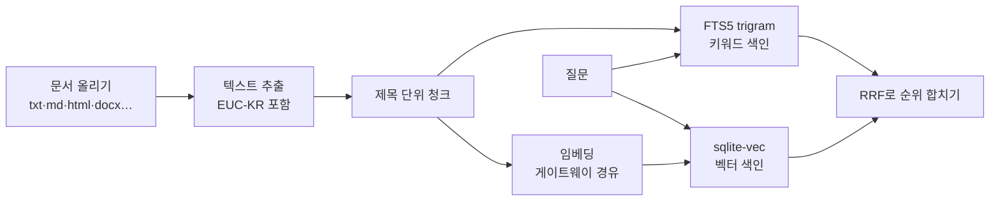

# 문서 RAG

운영 매뉴얼, 설계서, API 명세 같은 사내 문서를 올려 두고 질문으로 찾는다. 키워드 검색과 의미 검색을 함께 돌려 순위를 합친다.

<figure><figcaption>"SLA 위반 경고는 언제 나오나" 검색. 결과마다 키워드 순위와 의미 순위가 붙는다.</figcaption></figure>

## 동작

- **키워드**: FTS5 trigram에 두 글자 낱말 보완 검색을 더했다. 한국어 조사·어미가 붙어도 찾는다.
- **벡터**: sqlite-vec 확장(설치 패키지에 포함). 확장이 없으면 직접 계산한다.
- **임베딩은 게이트웨이를 거친다.** 개인정보 보호, 데이터 등급 라우팅, 사용량 계량이 그대로 적용된다. 사내 로컬 임베딩 모델을 쓰면 문서가 밖으로 나가지 않는다.
- 임베딩 별칭이 없는 컬렉션은 키워드 검색만 한다.

## 컬렉션과 권한

- 컬렉션은 워크스페이스에 속하고, 그 구성원만 검색한다.
- 컬렉션마다 임베딩 별칭과 데이터 등급을 정한다.
- 임베딩 모델을 바꾸면 **다시 임베딩**으로 전체를 새로 만든다.

## 받는 형식

txt, md, html, csv, json, xml, sql, 소스 코드, docx. PDF와 HWP는 아직 받지 않는다.

## 다른 도구에서 쓰기

MCP 허브의 `docs__search` 도구로 Claude Code, AX-NAVI, 플랫폼 에이전트가 같은 검색을 쓴다.
