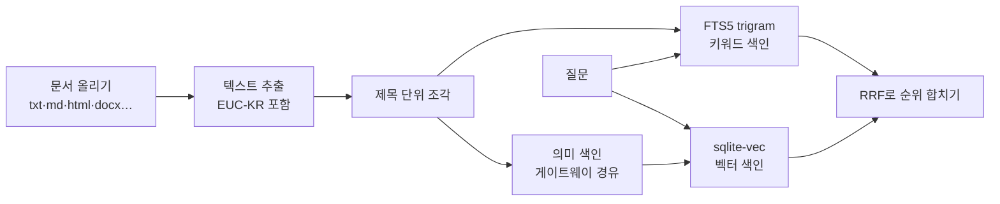

# 문서 검색

운영 매뉴얼, 설계서, API 명세 같은 사내 문서를 올려 두고 질문으로 찾는다. 키워드 검색과 의미 검색을 함께 돌려 순위를 합친다. 메뉴 **AI 통제 › 문서 검색**(0.9.1 전 이름은 '문서 RAG').

<figure><figcaption>"처리 기한 초과 경고는 언제 나오나" 검색. 결과마다 키워드 순위와 의미 순위가 붙는다.</figcaption></figure>

## 동작



- **키워드**: FTS5 trigram에 두 글자 낱말 보완 검색을 더했다. 한국어 조사·어미가 붙어도 찾는다.
- **의미 검색**: 조각마다 의미 색인(임베딩 벡터)을 만들어 sqlite-vec 확장(설치 패키지에 포함)에 둔다. 확장이 없으면 직접 계산한다.
- **의미 색인은 게이트웨이를 거친다.** 개인정보 보호, 데이터 등급 경로 규칙, 사용량 계량이 그대로 적용된다. 사내 의미 검색 모델을 쓰면 문서가 밖으로 나가지 않는다.
- 의미 검색 모델을 정하지 않은 문서함은 키워드 검색만 한다.

## 문서함과 권한

- 문서함은 워크스페이스에 속하고, 그 구성원만 검색한다.
- 문서함마다 의미 검색 모델(별칭)과 데이터 등급을 정한다.
- 의미 색인이 빠진 조각은 **빠진 의미 색인 채우기**로 다시 만든다.

## 받는 형식

txt, md, html, csv, json, xml, sql, 소스 코드, docx(EUC-KR 포함), PDF(한글 글꼴 포함, 쪽마다 절), 한글(HWP 5.0·HWPX). 암호가 걸린 문서와 글자 층이 없는 스캔 PDF 는 이유와 함께 거절한다(OCR 없음).

## 고친 문서 다시 올리기 — 새 버전으로 바꾸기

매뉴얼을 고쳐 같은 파일 이름으로 다시 올리면 화면이 묻는다. **새 버전으로 바꾸기**를 고르면 새 문서를 다 넣은 뒤 이전 버전을 지운다 — 이전 버전이 남아 채팅·현업 창구 답변 근거에 옛 내용이 섞이던 문제를 막는다. **따로 추가**를 고르면 둘 다 남긴다. 내용이 완전히 같은 파일은 예전처럼 거절한다.

문서 목록에는 이름마다 **최신 버전 한 줄**만 보인다. 이전 버전이 있으면 제목 앞에 '이전 버전 2개' 표시가 붙고, 왼쪽 ▸ 를 눌러 펼쳐 본다. 이전 버전도 검색 근거에 섞일 수 있어 지우기를 권한다. 조각 칸의 `12/12` 는 나눈 조각 수 중 의미 색인이 된 수다.

<figure><figcaption>운영 매뉴얼을 고쳐 같은 이름으로 다시 올린 순간. '따로 추가'로 남긴 예전 버전은 목록에 '이전 버전 N개'로 표시된다.</figcaption></figure>

## 다른 도구에서 쓰기

MCP 허브의 `docs__search` 도구로 Claude Code, AX-NAVI, 플랫폼 에이전트가 같은 검색을 쓴다. 문서함 목록은 `docs__collections`.

## AX-DataLake 문서 함께 찾기

[AX-DataLake](/datalake/documents.md)가 있는 현장은 레이크의 문서 묶음을 문서 검색·채팅·현업 창구·`docs__search`에서 함께 찾는다. 레이크가 없으면 지금과 똑같다.

```yaml
docs:
  lake:
    url: http://lake.corp.local:8790
    key: ${env:HNIX_AX_LAKE_KEY}   # 레이크 '내 API 키' — query 범위
    collections: []                # 비우면 키가 볼 수 있는 묶음 모두
    workspaces: []                 # 주면 그 워크스페이스 구성원만(관리자·감사자는 늘 봄)
    timeoutMs: 4000
```

- **권한** — 레이크 쪽 권한은 키를 만든 레이크 사용자의 역할 그대로다. 묶음 조회 권한·열 가림·행 제한·감사는 레이크가 건다. 분석가 역할 사용자로 키를 만들기를 권한다.
- **순위** — 플랫폼 문서(키워드·의미)와 레이크 결과를 함께 RRF로 합친다. 결과에 `레이크 · <묶음>`과 파일 경로가 붙는다.
- **레이크가 멈추면** — `timeoutMs` 안에 답이 없거나 닿지 않거나 권한으로 막히면, 결과에 경고 한 줄을 남기고 플랫폼 문서만으로 답한다.
- **현업 창구** — '근거 — 문서함'에서 레이크 묶음을 고를 수 있다. 창구의 매뉴얼 보강은 플랫폼 문서함에만 넣는다.
- **두 번 올리지 않기** — 같은 문서를 플랫폼 문서함과 레이크에 함께 두지 않는다. 레이크에 있으면 레이크가 원본이다.
