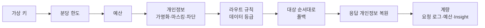

# LLM 게이트웨이

모든 모델 호출이 지나는 관문이다. 도구들은 프로바이더 API 키를 모르고, 게이트웨이가 발급한 가상 키(`hx-…`)만 쓴다.

## 호출 방법

| 경로 | 형식 | 비고 |
|---|---|---|
| `POST /v1/chat/completions` | OpenAI | 대상이 Anthropic이면 자동 변환한다(스트리밍 포함) |
| `POST /v1/messages` | Anthropic | Anthropic 대상만 |
| `POST /v1/embeddings` · `GET /v1/models` | OpenAI | 임베딩은 OpenAI 호환 대상(로컬 임베딩 모델 등) |

```bash
curl http://ax-platform:8700/v1/chat/completions \
  -H "Authorization: Bearer hx-..." -H "content-type: application/json" \
  -d '{"model":"hnix-local","messages":[{"role":"user","content":"안녕"}]}'
```

OpenAI SDK나 OpenAI 호환 클라이언트는 주소와 키만 바꾸면 된다.

## 처리 순서



- **모델 별칭**: 도구는 `hnix-local`, `hnix-claude` 같은 별칭으로 부른다. 별칭 하나에 대상을 여러 개 두면 앞에서부터 시도하고, 실패하면 다음으로 넘어간다(스트림은 첫 바이트 전까지).
- **데이터 등급**: `public` · `internal` · `confidential` · `restricted`. 요청 헤더 `x-hnix-data-class`로 키·워크스페이스 기본값보다 올릴 수만 있다. `restricted`는 사내 로컬 프로바이더로만 간다.
- **개인정보 보호**: 주민등록번호, 전화번호, 이메일, 카드번호, 사업자번호와 직접 정한 패턴을 찾아 가명화하거나 가리거나 차단한다. 가명화한 값은 응답에서 되돌린다.
- **예산**: 전체·워크스페이스·사용자·키 단위, 월·일 기준으로 금액이나 토큰 상한을 건다. 상한에 닿으면 경고만 하거나 429로 막는다(hard stop).
- **선택 헤더**: `x-hnix-project`, `x-hnix-work-item`(SR·CR 번호), `x-hnix-client`. Insight가 이 값으로 묶는다.

## 가상 키

| 권한 | 쓰는 곳 |
|---|---|
| `llm` | 모델 호출 (PMS-X AI, AX-NAVI 게이트웨이 경로, 사내 앱) |
| `ingest` | 사용량 올리기 (Claude Code 텔레메트리, AX-NAVI 실행 요약, 수집기) |
| `ingest_org` | 조직 단위 사용량 수집. 관리자만 발급하고, 기록의 이메일로 사용자를 찾는다 |
| `mcp` | MCP 허브 도구 호출 |

키마다 허용 모델, 분당 한도, 데이터 등급, 만료일을 건다. 키 원문은 발급할 때 한 번만 보이고, 서버에는 해시만 남는다.

## 저장하지 않는 것

- 요청·응답 본문은 저장하지 않는다. 요청 로그에는 시각, 키, 모델, 토큰, 비용, 결과, 개인정보 탐지 건수만 남는다.
- 프로바이더 API 키는 암호화 저장소(AES-256-GCM)에만 두고 화면에 다시 보이지 않는다.
