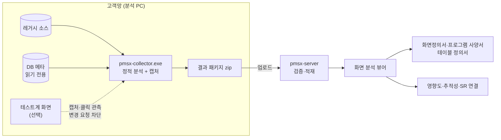

# As-Is 화면 분석

레거시 시스템을 화면 단위로 해부한다. 수집기가 소스·DB·화면을 분석해 결과 패키지를 만들고, 서버가 그것을 적재해 뷰어로 보여 준다. 분석자는 뷰어에서 보정하고 확정한다.

## 흐름



## 버튼 하나의 워크플로우

<figure><figcaption>캡처 위 버튼을 누르면 이벤트 → 함수 → API → 컨트롤러 → 서비스 → SQL → 테이블(CRUD) 흐름이 펼쳐진다.</figcaption></figure>

모든 연결선에는 **출처(정적·동적·수동)와 신뢰도**가 붙는다. 테스트계에서 실제로 관측한 요청은 동적(100%), 소스만으로 찾은 것은 정적, 분석자가 고친 것은 수동이다. 다시 수집해도 수동 보정은 유지된다.

## 지원 기술

| 화면 기술 | 서버·데이터 | 화면 그림 |
|---|---|---|
| JSP + jQuery | Spring (MyBatis·iBatis) | 실제 캡처 · 정적 렌더링(서버 없이 JSP → HTML) |
| Struts 1 + 자체 프레임워크 | Action·DispatchAction + 쿼리 XML | 실제 캡처 · 정적 렌더링 |
| Nexacro N/14/17 · XPlatform · MiPlatform | transaction → 서버 매핑 | 소스 좌표 와이어프레임 |
| WebSquare 5 | submission → 서버 매핑 | 와이어프레임 |
| Vue 2/3 · React | 라우터·axios/fetch → REST | 실제 캡처(SPA 라우트 순회) |
| WinForms | C# → ADO.NET·Dapper·EF·SP | 데스크톱 캡처(UI Automation) · 와이어프레임 |
| ASP.NET WebForms · MVC | 코드비하인드·Controller | 실제 캡처 |
| DB 메타 | Oracle · Tibero · PostgreSQL · SQL Server · MySQL/MariaDB | — |

테스트 서버가 없어도 된다. HTML 계열은 정적 렌더링으로, Nexacro·WebSquare·WinForms는 와이어프레임으로 화면 그림을 만든다.

<figure><figcaption>Nexacro 런타임 없이 소스 좌표로 그린 와이어프레임</figcaption></figure>

## ERD와 영향도

FK가 없는 레거시 DB도 SQL의 JOIN 패턴으로 테이블 관계를 추정해 ERD에 점선으로 그리고, 분석자가 확정하거나 기각한다.

<figure><figcaption>ERD — FK는 실선, 추정 관계는 점선(신뢰도 표시)</figcaption></figure>

**영향도 분석**은 테이블(컬럼)·함수·API·SQL을 바꾸면 영향받는 화면·버튼·배치와 관련 SR·결함, 담당자를 보여 준다. 같은 결과를 MCP 도구 `pmsx__impact`로 AX-NAVI나 에이전트가 쓴다.

## 새 시스템 추가

```bat
pmsx-collector.exe init D:\src\hr-web --code HR --name 인사시스템   :: 기술 자동 감지, 설정 초안
pmsx-collector.exe doctor -c collector.yaml                         :: 브라우저·DB·URL·글꼴 점검
pmsx-collector.exe run -c collector.yaml                            :: 결과 패키지
pmsx-collector.exe upload -c collector.yaml --server https://pmsx.local --user analyst
```

시스템 등록은 코드와 이름만 하면 된다. 화면·서버 기술과 DB 종류는 수집기가 소스에서 감지하고, 첫 업로드 때 서버가 빈칸을 채운다. 소스가 바뀌면 `--incremental`로 다시 수집한다.

## 수집 안전성

테스트계 화면을 캡처할 때 수집기는 클릭을 관측하되 서버로 가는 **변경 요청을 차단**한다. 모든 샘플 캡처에서 서버에 도달한 변경 요청은 0건이었다.
