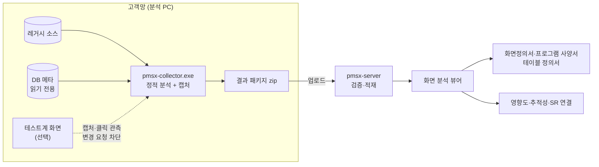

# As-Is 화면 분석

레거시 시스템을 화면 단위로 해부한다. 수집기가 소스·DB·화면을 분석해 결과 패키지를 만들고, 서버가 그것을 적재해 뷰어로 보여 준다. 분석자는 뷰어에서 보정하고 확정한다.

## 흐름



## 버튼 하나의 워크플로우

<figure><figcaption>캡처 위 버튼을 누르면 이벤트 → 함수 → API → 컨트롤러 → 서비스 → SQL → 테이블(CRUD) 흐름이 펼쳐진다.</figcaption></figure>

모든 연결선에는 **출처(정적·동적·수동)와 신뢰도**가 붙는다. 테스트계에서 실제로 관측한 요청은 동적(100%), 소스만으로 찾은 것은 정적, 분석자가 고친 것은 수동이다. 다시 수집해도 수동 보정은 유지된다.

## 뷰어 화면 구성

시스템 → 메뉴 → 화면 트리에서 화면을 고르면 가운데에 캡처와 분석 탭이, 오른쪽에 선택한 요소의 워크플로우가 나온다.

- **열린 화면 탭** — 여러 화면을 탭으로 열어 두고 오간다.
- **배치** — 기본 / 상하분할 / 드로어 중에서 고른다. 좁은 모니터에서는 드로어가 편하다.
- **화면 요약 배너** — 유형(조회 · 입력 · 조회+입력), 한 줄 목적("사원관리 화면은 TB_DEPT 등 2개 테이블을 조회하고 TB_EMP 등 2개 테이블에 등록·수정하는 화면입니다"), 이벤트·SQL·읽기/쓰기 테이블·프로시저 건수.
- **컨트롤 ID 표시** — 캡처 위 핫스팟에 소스의 컨트롤 ID를 띄운다. 이벤트가 있는 요소에는 ⚡ 표시가 붙는다.

## 화면 조망 탭

버튼 하나가 아니라 **화면 전체**를 한눈에 보는 탭들이다. 모두 수집된 그래프에서 규칙으로 만들기 때문에 AI 없이 동작한다.

| 탭 | 보여 주는 것 |
|---|---|
| 캡처 | 실제 캡처 · 정적 렌더링 · 와이어프레임 위 번호 핫스팟 |
| 컴포넌트 · 이벤트 목록 | 화면의 모든 요소와 이벤트, 좌표가 없는 요소까지 |
| CRUD | 이벤트 × 테이블 C/R/U/D |
| 코드 순서도 | 이벤트를 의도별(초기화 · 조회 · 저장·수정 · 삭제 · 기타)로 묶은 카드 맵과 **공유 로직**(두 이벤트 이상이 부르는 함수·프로시저) |
| 통합 추적 | 조망 매트릭스 · 단계 추적 · 네트워크 (아래) |
| 데이터 흐름도 | 읽는 테이블 → 화면 → 쓰는 테이블 (파랑 읽기 / 빨강 쓰기) |
| 한국어 설명 | 워크플로우를 단계별 문장으로 푼다. 단계를 펼치면 소스, **원본 소스** 대화상자는 호출 트리 + 코드 |
| 트리거 | 이 화면의 등록·수정·삭제가 실행시키는 DB 트리거와 **연쇄**(트리거 → 테이블 → 트리거, 최대 5단계) |

<figure><figcaption>코드 순서도 — 이벤트를 의도별로 묶고 SQL·테이블·호출·API 건수와 CRUD를 붙인다.</figcaption></figure>

### 통합 추적

통합 추적은 같은 그래프를 세 가지 방법으로 보여 준다.

**조망 매트릭스**는 이벤트 × 레이어(화면 · 프론트 · API · 서버 · SQL · 테이블) 표다. 옆에 인사이트 다섯 가지가 붙는다 — 핵심 데이터(가장 많이 쓰이는 테이블), 주요 참조, 공유 함수, 무거운 이벤트, CRUD 프로파일.

<figure><figcaption>조망 매트릭스 — 이벤트마다 레이어별 노드, 오른쪽에 인사이트</figcaption></figure>

**단계 추적**은 이벤트 하나(또는 화면 전체)의 경로를 단계 카드로 따라간다. 카드의 "다음 단계"를 누르며 흐름을 탄다. 상세도는 세 단계다.

| 상세도 | 보이는 노드 | 쓰는 사람 |
|---|---|---|
| **업무** | 이벤트와 테이블만, 테이블 설명과 CRUD로 — "사원 데이터를 등록합니다" | 현업, PM |
| **로직** | + 프론트·서버 함수 | 분석자 |
| **기술** | + API URL · SQL ID · 프로시저 | 개발자 |

<figure><figcaption>단계 추적 — 왼쪽은 레이어별 노드 수와 이벤트, 오른쪽은 단계 카드</figcaption></figure>

**네트워크**는 이벤트↔테이블 그래프다. 노드 크기는 연결 수, 선 색은 CRUD다. 노드를 누르면 1촌 · 2촌 · 전체 이웃을 강조하고, 이벤트를 두 번 누르면 뷰어에서 그 요소를 선택한다. 테이블에 닿지 않는 이벤트는 그래프에서 빼고 건수만 알려 준다.

<figure><figcaption>네트워크 — TB_EMP를 저장·삭제·엑셀 이벤트가 함께 쓰는 것이 한눈에 보인다.</figcaption></figure>

### 데이터 흐름도 · 한국어 설명 · 트리거

<figure><figcaption>데이터 흐름도 — 왼쪽은 읽는 테이블, 오른쪽은 쓰는 테이블</figcaption></figure>

한국어 설명은 워크플로우를 그대로 문장으로 옮긴다. 예를 들어 "EmpServiceImpl.saveEmp 에서 SQL EmpMapper.insertEmp 를 실행해 TB_EMP 에 등록(C)합니다"처럼 쓴다. AI 설명 초안([SM 운영과 AI 보조](/pmsx/sm-ai.md))과 달리 규칙 기반이라 항상 같은 결과가 나온다.

<figure><figcaption>한국어 설명 — 이벤트별 한 줄 요약과 단계 문장, 원본 소스</figcaption></figure>

트리거 탭은 화면이 직접 부르지 않지만 DB가 대신 실행하는 일을 드러낸다. 수정 한 번이 이력 테이블에 쓰는 트리거를 거쳐 또 다른 트리거로 이어지는 경로까지 보여 준다.

<figure><figcaption>트리거 — 화면이 일으키는 DB 트리거와 연쇄 경로</figcaption></figure>

## 원본이 숨긴 것까지

캡처에는 화면에 보이는 것만 찍힌다. 하지만 레거시 화면에는 `visible="false"` 컨트롤, `display:none` 영역, 숨긴 그리드 열이 많고, 그 안에도 이벤트와 데이터 흐름이 있다. 수집기는 화면 기술별로 이것들을 찾아 **원본 숨김**으로 기록한다.

| 화면 기술 | 숨긴 컨트롤 | 숨긴 그리드 열 |
|---|---|---|
| JSP 등 HTML 계열 | `type="hidden"`(id·name 있는 것), `display:none` · `visibility:hidden`, `hidden` 속성 — 조상이 숨겨져도 숨김 | 숨긴 `th` |
| Nexacro · XPlatform · MiPlatform | `visible="false"` (Div면 안쪽 전체) | `size="0"` · `visible="false"` 열 |
| WebSquare | `display:none` · `visibility:hidden`, `visible="false"` | `hidden="true"` · 폭 0 열 |
| Vue · React | `v-show="false"` · `v-if="false"`, `display:none`, `hidden` | 숨긴 열 |
| WinForms | `.Visible = false` (부모 컨테이너 포함) | 열 `.Visible = false` |

뷰어에서는 이렇게 보인다.

- 캡처 아래 접힌 **원본 숨김 컨트롤 (n)** 목록 — 이름 · 코드 · 유형 · ⚡. 누르면 그 요소가 선택돼 워크플로우가 열린다.
- 그리드 핫스팟의 **원본 비표시 N** 배지. 와이어프레임에서는 그리드 오른쪽에 빗금 블록으로 그린다.
- 요소 패널의 **그리드 컬럼** 탭 — 전체 열, 머리글 · 필드 · 폭 · 표시 · 편집 여부. "원본 비표시 열만" 필터.

<figure><figcaption>그리드의 "원본 비표시 2" 배지와 캡처 아래 원본 숨김 컨트롤 목록</figcaption></figure>

원본 숨김은 분석자가 뷰어에서 직접 숨긴 요소와 **따로 관리**한다. 다시 수집해도 분석자의 숨김 표시는 그대로 남는다.

## 지원 기술

| 화면 기술 | 서버·데이터 | 화면 그림 |
|---|---|---|
| JSP + jQuery | Spring (MyBatis·iBatis) | 실제 캡처 · 정적 렌더링(서버 없이 JSP → HTML) |
| Struts 1 + 자체 프레임워크 | Action·DispatchAction + 쿼리 XML | 실제 캡처 · 정적 렌더링 |
| Nexacro N/14/17 · XPlatform · MiPlatform | transaction → 서버 매핑 | 소스 좌표 와이어프레임 |
| WebSquare 5 | submission → 서버 매핑 | 와이어프레임 |
| Vue 2/3 · React | 라우터·axios/fetch → REST | 실제 캡처(SPA 라우트 순회) |
| WinForms | C# → ADO.NET·Dapper·EF·SP | 데스크톱 캡처(UI Automation) · 와이어프레임 |
| ASP.NET WebForms · MVC | 코드비하인드·Controller | 실제 캡처 |
| DB 메타 | Oracle · Tibero · PostgreSQL · SQL Server · MySQL/MariaDB | — |

테스트 서버가 없어도 된다. HTML 계열은 정적 렌더링으로, Nexacro·WebSquare·WinForms는 와이어프레임으로 화면 그림을 만든다.

<figure><figcaption>Nexacro 런타임 없이 소스 좌표로 그린 와이어프레임</figcaption></figure>

## 분석 관리

- **편집 모드**: 핫스팟 추가·이동, 연결선 추가·수정·삭제, 요소 숨김. 수동 보정은 재수집 후에도 남는다.
- **상태와 진척**: 화면마다 미착수 → 분석 중 → 검토 요청 → 확정. 분석 진척 화면에서 담당자·메뉴별로 보고 일괄 배정한다.
- **메모와 이력**: 업무 규칙 메모, 분석 이력, 수집 회차 간 비교(diff).
- **산출물 출력**: 화면정의서 · 프로그램 사양서 · 테이블 정의서를 xlsx/pptx로 낸다.
- **영향도 분석**: 테이블(컬럼)·함수·API·SQL을 바꾸면 영향받는 화면·버튼·배치와 관련 SR·결함, 담당자를 보여 준다. 같은 결과를 MCP 도구 `pmsx__impact`로 AX-NAVI나 에이전트가 쓴다.

테이블·트리거·패키지 같은 DB 쪽 분석과 ERD는 [DB · PL/SQL 분석](/pmsx/db.md)에 있다.

## 새 시스템 추가

```bat
pmsx-collector.exe init D:\src\hr-web --code HR --name 인사시스템   :: 기술 자동 감지, 설정 초안
pmsx-collector.exe doctor -c collector.yaml                         :: 브라우저·DB·URL·글꼴 점검
pmsx-collector.exe run -c collector.yaml                            :: 결과 패키지
pmsx-collector.exe upload -c collector.yaml --server https://pmsx.local --user analyst
```

시스템 등록은 코드와 이름만 하면 된다. 화면·서버 기술과 DB 종류는 수집기가 소스에서 감지하고, 첫 업로드 때 서버가 빈칸을 채운다. 소스가 바뀌면 `--incremental`로 다시 수집한다.

## 수집 안전성

테스트계 화면을 캡처할 때 수집기는 클릭을 관측하되 서버로 가는 **변경 요청을 차단**한다. 모든 샘플 캡처에서 서버에 도달한 변경 요청은 0건이었다.
