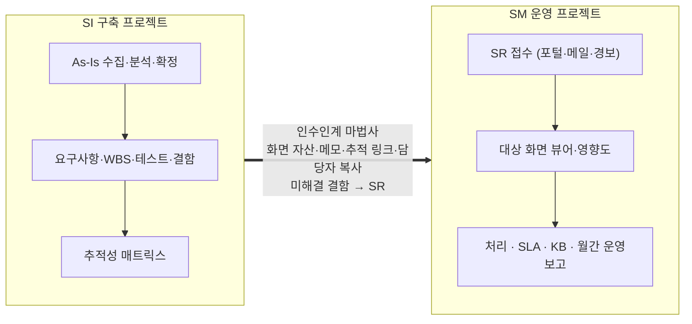

# 인수인계와 구현 명세

## SI에서 SM으로

인수인계 마법사는 구축 프로젝트의 화면 분석, 업무 메모, 추적 링크, 담당자를 운영 프로젝트로 복사하고, 미해결 결함을 SR로 만든다. 운영팀은 첫날부터 화면 뷰어와 영향도를 쓴다.

## 인수인계 갭 리포트

넘기기 전에 비어 있는 곳을 규칙으로 점검해 준비도 점수와 인수자 질문을 만든다. AI를 쓰지 않으므로 결과가 매번 같다.

<figure><figcaption>항목별 가중·점수, 준비도 판정, 자동 생성된 인수자 질문</figcaption></figure>

| 항목 | 보는 것 |
|---|---|
| 분석 완료율 | 확정(DONE)된 화면 비율 |
| 요소 매칭률 | 서버 흐름과 이어지지 않은 버튼·입력 요소 |
| 연결 확정률 | 신뢰도가 낮은 채 확정되지 않은 연결 |
| 업무 메모 보유율 | 메모가 없는 화면 |
| 산출물 확정률 | 승인되지 않은 산출물 |
| 담당 배정률 | 담당자가 없는 화면 |
| 미해결 결함 | 열린 결함 수와 심각도 |

인수자 질문은 "미해결 결함 DEF-0003의 원인·처리 계획·임시 조치는 무엇입니까?", "'사원관리' 화면의 '인쇄' 버튼은 어떤 서버 기능을 처리합니까?"처럼 빈 곳마다 구체적으로 만들어진다. 리포트는 파일로 내려받아 인수인계 회의에 쓴다.

## 인수인계 이해도 퀴즈

갭 리포트가 "무엇이 비었나"를 본다면, 퀴즈는 "인수자가 실제로 알게 됐나"를 본다. 메뉴 **운영 › 인수인계 퀴즈**(만들기·결과는 PM·PL).

AI 없이 이미 가진 사실로 출제한다. 정답이 분석 그래프에서 나오므로 채점이 분명하고, 틀린 문제는 근거를 해설로 보여 준다.

| 분야 | 예 | 근거 |
|---|---|---|
| 화면·데이터 | "'사원관리(HR0101)' 화면에서 '저장'을 실행하면 데이터가 바뀌는 테이블은?" · "테이블 TB_EMP의 데이터를 바꾸는 화면은?" | As-Is CRUD 매트릭스 |
| SR 이력 | "SR-0012 '입사일 검증'은 어느 화면에 대한 요청이었나?" | SR의 대상 화면 |
| 업무 절차 | "'장애 대응' 절차에서 '영향 범위 확인' 다음 단계는?" | 업무 템플릿 |
| SLA | "SLA 정책 '긴급'의 해결 목표 시간은?" | SLA 정책 |

- 대상 시스템과 문제 수(3~30)를 고르면 분야를 번갈아 뽑아 한쪽으로 치우치지 않게 만든다. 같은 퀴즈는 다시 열어도 문제와 보기 순서가 같다.
- 응시 화면에는 정답과 해설이 나가지 않는다. 제출하면 점수, 문제별 정답·해설, 분야별 결과가 나온다.
- 결과에서 사람별 응시 횟수·최고·최근 점수, 문제별·분야별 정답률을 본다. 정답률이 낮은 분야가 보충 인수인계 대상이다.

## 구현 명세 내보내기

SR이나 CR 하나를 개발 도구의 입력으로 묶는다.

| 담기는 것 | 출처 |
|---|---|
| 요구사항 | SR·CR 본문과 처리 코멘트 |
| 대상 버튼 워크플로우 | As-Is 그래프 |
| 영향 테이블·컬럼 | 영향도 분석 |
| 소스 위치와 스니펫 | 수집 결과 |
| 작업 목록 | 흐름을 따라 고칠 곳. 여러 화면이 함께 쓰는 공통 함수는 따로 표시한다 |
| 테스트 케이스 | 흐름과 CRUD에서 도출 |

SR 상세 › **구현 명세** › Markdown 또는 JSON. MCP 도구 `pmsx__spec`으로도 받는다. AX-NAVI 같은 코딩 에이전트에 그대로 넣으면 어디를 고쳐야 하는지부터 시작한다.

- As-Is 그래프를 따라 결정론적으로 만들며, AI나 외부 호출을 쓰지 않는다.
- 버튼이 많은 화면을 통째로 넣지 않는다. 입력이 길어지면 정작 중요한 흐름이 묻히기 때문이다.
- 소스 스니펫이 들어가므로 내부 역할만 내려받을 수 있다.
